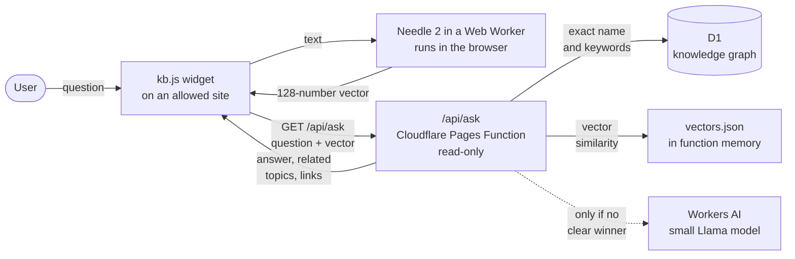
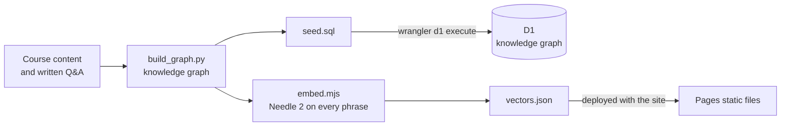
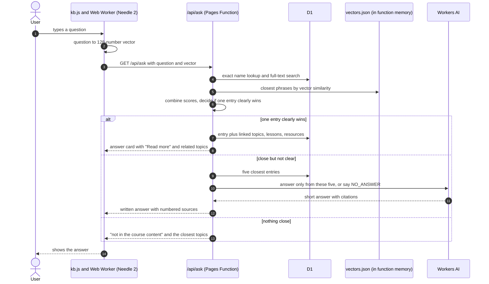

# Simple RAG via a browser model

A small, low-cost retrieval-augmented (RAG) chat: the meaning of a question is worked out by a model running in the user's browser, and a read-only Cloudflare function finds the answer in a knowledge graph. It is the Ask chat behind the [FDE Training Program](https://fde-training-program.pages.dev). It answers questions about AI, programming, cloud and security, the FDE role, the program itself, and MedTech and Pharma quality topics, using only the program's content.

It runs on free tiers: Cloudflare Pages, D1 and the Workers AI daily allowance, with no paid model API.

**Live service:** https://quick-chat-program.pages.dev (open it to ask questions and browse the knowledge map)

## Architecture

**Answering a question (runtime)**



**Building the knowledge (build time, on a developer machine)**



**Build time.** `build_graph.py` turns the course content and the written Q&A into a knowledge graph: about 3,000 entries (concepts, lessons, lesson sections, learning path steps, resources and questions with answers) and the links between them (related, taught in, part of, recommended in). `embed.mjs` runs Needle 2 over every phrase a user might type for each entry and stores the vectors in a small static file. The graph goes into D1; the vectors ship with the site.

**In the browser.** The widget loads Needle 2 into a Web Worker the first time Ask is opened. The model files come from this site and are checked against a known hash. For each question the model produces a 128-number vector that captures its meaning. The question never goes to an AI service from the browser.

**On Cloudflare.** One read-only function answers. It is the only part that can read the database, and the browser never talks to D1 directly.

### One question, step by step



### How the match is decided

| Signal | Where it runs | What it catches |
|---|---|---|
| Exact name | D1 aliases | "GxP", "SIPOC", "what is RAG": straight to the definition |
| Keywords | D1 full-text index (FTS5) | Shared words, with filler words ignored |
| Meaning | Vector similarity against `vectors.json` | Paraphrases and casual wording, such as "why does chatgpt make stuff up" |

An entry wins on meaning alone only with a strong score (0.90, or 0.86 when it also shares keywords) and a clear gap to the next entry. Otherwise the five best candidates go to the fallback model, which may only use them. Off-topic questions find nothing close and are declined.

### Why the model runs in the browser

Needle 2 takes about 180 ms of processing for one question. A free Cloudflare function allows 10 ms of processing per request, so the model cannot run on the server for free. In the browser it costs nothing and keeps the question's meaning on the user's device. The server only does cheap work: database lookups and one pass of int8 vector arithmetic.

### Quality

A held-out set of 301 questions, written without seeing the content, measures the chat. The current build answers 94 percent of in-scope questions well and declines all 30 off-topic ones. Run `./setup.sh eval` to score a change before publishing it.

## Use it on a site

Add one line to any page on an allowed site:

```html
<script src="https://quick-chat-program.pages.dev/kb.js" defer></script>
```

An "Ask" button appears at the bottom right. The panel uses the host page's colours when the page defines them, so it follows light and dark mode. Allowed sites are set in `ALLOWED_ORIGINS`.

## Run it locally

You need Python 3.10 or newer, Node.js 18 or newer, and a copy of the [FDE Training Program](https://github.com/Elamurugan-Nallathambi/fde-training) next to this folder.

```bash
git clone https://github.com/Elamurugan-Nallathambi/fde-training.git
```

```bash
git clone https://github.com/Elamurugan-Nallathambi/simple-rag-via-browser-model.git
```

```bash
cd simple-rag-via-browser-model && cp .env.example .env && ./setup.sh setup
```

`setup` downloads the Needle 2 weights (checked against a known hash), builds the graph and the vectors, loads a local D1 database and starts the service at http://127.0.0.1:8792. The fallback answers need Workers AI, which uses your Cloudflare account even locally (`npx wrangler login`).

| Command | What it does |
|---|---|
| `./setup.sh build` | Rebuild the graph (`out/`) and the vectors (`public/vectors.json`) from the latest content |
| `./setup.sh load` | Load the graph into the local D1 database |
| `./setup.sh start`, `stop`, `restart`, `status`, `logs` | Run the local service |
| `./setup.sh eval` | Score the chat on the test set; writes `eval/report.json` |
| `CONFIRM=yes ./setup.sh publish` | Rebuild, then deploy the data and the site |

## Layout

| Path | What it is |
|---|---|
| `content/*.json` | Written questions and answers (foundations, tech, industry, FDE work, glossary, learning path) |
| `build/build_graph.py` | Builds the knowledge graph from this content and the FDE program content |
| `build/embed.mjs` | Embeds every phrase with Needle 2, one engine per CPU core |
| `src/api.js`, `functions/` | The read-only API: `/api/ask`, `/api/node/:id`, `/api/search`, `/api/overview` |
| `public/kb.js`, `public/kb.css` | The Ask widget |
| `public/index.html` | The knowledge map page |
| `eval/` | The held-out test set and the scorer |

## Settings

Everything account-specific lives in `.env`, which is never committed (see `.env.example`). `./setup.sh` renders `wrangler.toml` from `wrangler.toml.template` with those values.

| Setting | Purpose |
|---|---|
| `CF_ACCOUNT_ID`, `PAGES_PROJECT`, `D1_DATABASE_NAME`, `D1_DATABASE_ID` | Your Cloudflare account, Pages project and D1 database (`npx wrangler d1 create <name>`) |
| `ALLOWED_ORIGINS` | Sites allowed to call the API |
| `FDE_DIR`, `KB_SITE_URL` | Where the program content is, and the site answers link to |
| `KB_LMS_URL`, `KB_EXTRA_TOPICS`, `KB_EXTRA_CONTENT`, `KB_EXTRA_EVAL` | Optional: an LMS that hosts topic courses, plus extra private course, answer and test folders |

## Security

The API only answers GET requests. It runs fixed SELECT statements with bound values, limits the size of every input, and only answers the allowed sites. The browser never touches the database. Do not add write routes.

## Credits

Needle 2 is by [Cactus Compute](https://github.com/cactus-compute/needle) (MIT licence), run in the browser with [needle-rs](https://github.com/geekgineer/needle-rs) (MIT licence). Their licence and notice files are in `public/needle/`.
